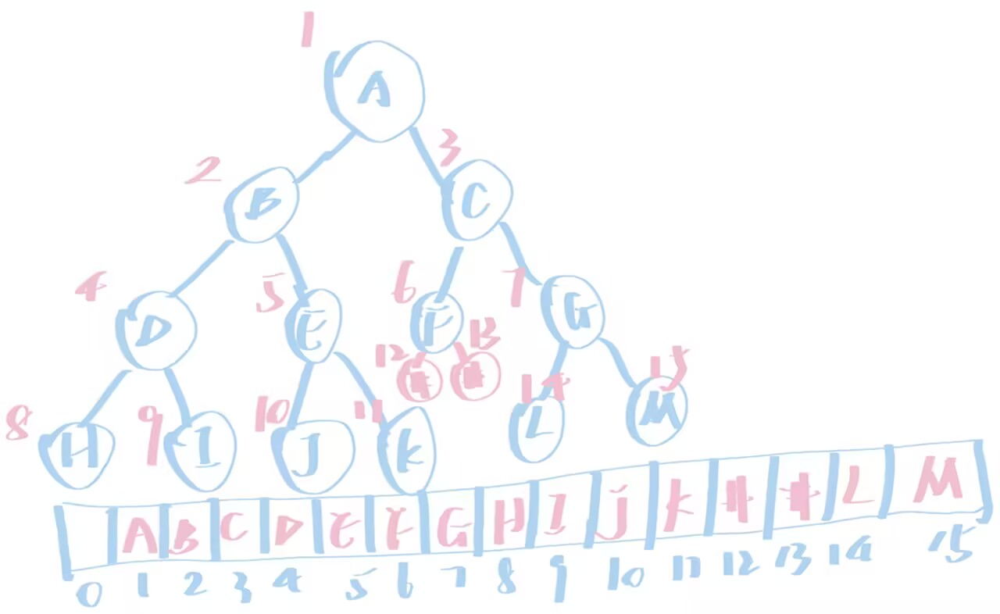

# step1.什么是树

1.**现在先了解什么是树，给树下一个定义。什么是二叉树？该如何定义一个二叉树？**

- 树：树是由n个结点构成的有限集合。
- 二叉树：二叉树是度小于等于2的树。

2.**在这一题中我们只讨论二叉树。请你思考，二叉树在c语言中应该如何存储？二叉树有哪些特点？**

- 二叉树的存储：
  - **顺序存储**：利用数组存储--将二叉树的节点按一定顺序编号，一般将根节点编号为1同时对应数组下标为1。具体情况如下：
  - **链式存储**：采用链表的形式存储--定义一个结构体，该结构体由数据、左指针、右指针
```
struct BTNode{
    int data;
    struct BTNode *lchild,*rchild;
};
```

- 二叉树的特点：
  - 每个节点最多有两个子树；
  - 是有序树，即子树有严格的左右顺序；
  - 可以是空二叉树;
  - 五种基本形态：空二叉树、只有根节点、左子树为空、右子树为空、根和左右子树。

> ### 使用顺序表完成二叉树操作--思考过程
> 初始化二叉树需要对每个节点都进行操作，如果一个一个的去手搓，不仅浪费时间而且还要考虑很多问题，所以对于这种需要进行大量重复操作的函数，我们可以通过for循环实现；创建根节点比较简单，但容易忘记写return；创建左右孩子比根节点要复杂一点，因为根节点的数组下标已经确定，但左右孩子的下标在封装函数时并不知道，所以在给data赋值时需要先用if判断下标的合理性，否则容易出现数组越界的情况；层序遍历，难在怎么实现一行结束后换行，我想的是for嵌套for，里面的for实现遍历，外面的for实现换行。最开始的想法是直接对层数进行计算，用到了pow,ceil等函数，运行的时候也成功了，但由于我对pow等不熟悉，并不知道这样用稳不稳妥，问了一下豆老师，好像确实不稳妥，所以我又开始思考怎么能不用到pow也能实现换行，知识有限，仍然用的是for循环，区别于第一次写的代码，这次从下标的归律出发，并利用其实现内层循环的条件限制，和外层循环的迭代。大概就这样了。

# step2.链二叉树

**为什么无法用for循环实现打印函数**  
for循环的实现依赖于条件判断，在顺序存储中，由于数组每个数据对应的下标是连续的，存储的数据也是连续的，就算所以用两个数的大小判断就能很轻松地实现循环从而打印函数，而链式存储的节点是离散的，只能通过指针寻找下一个节点，因此也就找不到合适的判断条件成功实现循环并打印链二叉树。

# step3.递归
递归函数调用自己的过程就像一个小人进入一个房间，先要通过一个考验，失败直接走出房间，成功就从一个大房间通过房间里的一扇门A进入和它相同布置的一个小房间，这个过程会循环直到来到最后一个房间，然后小人又从房间的另一扇门B出去，进入外层的房间，直到最后回到刚开始的那个大房间，如果把printf看作是小人要完成的任务，这个任务是设置在A的前面还是B的后面就代表着小人在每个房间完成任务的时间是不同的。因此只改变printf的位置就能改变每个节点打印的时间，从而实现三种不同的递归。

沿用上面的比喻，以前序遍历为例，这次每个房间里的小房间数量由1变到2，printf的任务点设在了第一个小房间的门A之前。小人再从头走到尾的过程中，在第一个房间先完成任务，然后从A进入第一个小房间，因为两间房相同，所以小人在完成任务后又进入小房间里的小小房间，如此直到最后一个房间即遍历过程中的第一个叶节点，小人从B门出来，又进入外层房间的第二个小房间的A门，小人如此继续走下去，直到走出最初的大房间，就实现了二叉树的前序遍历。

统计深度，为什么后面两个int不用指针变量？max不用指针变量，是因为这里将max_depht当作返回值交了上去，在调用函数时用变量借接住这个返回值，就能得到最大深度。如果使用指针变量，同样能够实现统计深度，不过思路不同，主要区别是用指针变量意味着每一层存最大值的地方一样，最大深度会直接保存在max_depth里。而currnt_depth如果使用了指针变量，子函数就会修改上一层的深度值，左右孩子的深度统计就会出错。

循环和递归都能实现重复，但实现重复的底层逻辑不同，循环是依靠重复执行一段代码，递归则是依靠函数调用自己。判断结束也不同，循环是在入口处判断，而递归则是在中间过程进行判断。


